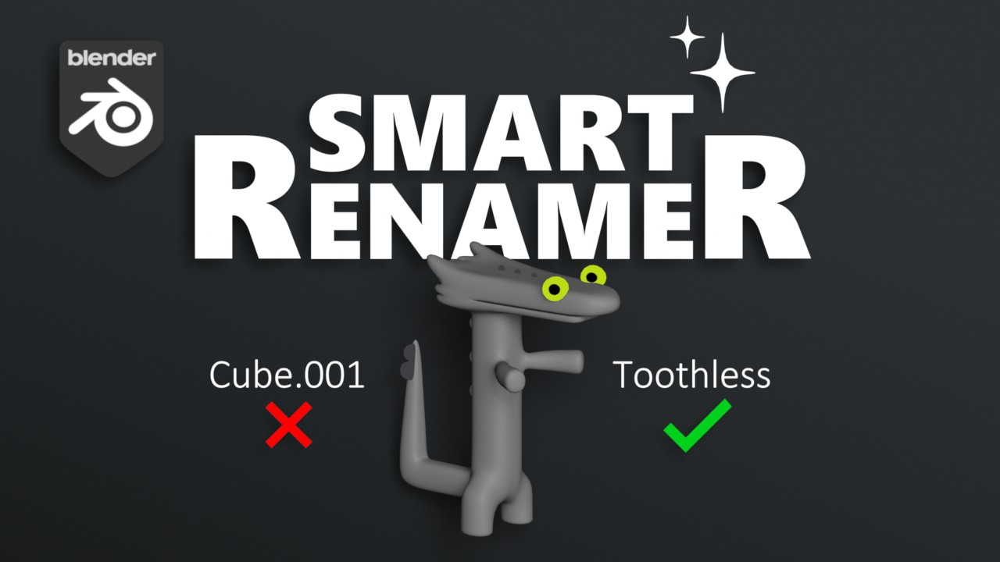

  

<h3 align="center">Stop naming <code>Cube.001</code>. Let Blender look at your objects and name them.</h3>

  
  
  
  

**Smart Renamer** is a Blender add-on that renames 3D objects from what they actually look like. It renders small views of each selected object, sends them with the object's metadata to a vision-language model (Google's Gemma 3), and applies a clean name in the naming convention you choose. Hundreds of objects are processed in the background while you keep working.

## How it works

1. **Capture.** For each object, the add-on renders isolated front (and optionally back) views with the rest of the scene hidden, plus an optional context view with an X-ray/wireframe overlay that shows where the object sits in the scene.
2. **Describe.** The images go to a Gemma 3 vision model together with the object's current name, collection, real-world dimensions and your optional context hint (for example *"car engine parts"*). Dimensions let it tell a 10 cm toy boat from a 100 m cargo ship.
3. **Stay consistent.** Names already given in the current batch are fed back to the model, so identical parts get identical names (all your pistons become `Piston`, not a mix of `Piston`, `Cylinder` and `EnginePart`).
4. **Scale.** A background queue handles large selections. A 27B → 12B → 4B model cascade with per-model cooldowns absorbs API rate limits instead of failing.

## Features

- **Vision-based naming** from rendered views, not just geometry statistics
- **Scene context** through X-ray/wireframe overlays
- **Front-only or front + back** capture (speed vs. accuracy)
- **Batch processing** in the background, with progress and cancel
- **Naming conventions** for any pipeline:

| Style | Example |
|---|---|
| Snake_Case | `sci_fi_crate` |
| CamelCase | `SciFiCrate` |
| lowerCamelCase | `sciFiCrate` |
| UPPER_SNAKE_CASE | `SCI_FI_CRATE` |
| Kebab-Case | `sci-fi-crate` |
| Unreal prefix | `SM_Crate` |
| Descriptive | `Old Wooden Crate` |

## Installation

1. Download [`dist/SmartRenamer_v1.0.zip`](dist/SmartRenamer_v1.0.zip).
2. In Blender, open **Edit > Preferences > Add-ons** and click **Install...**.
3. Select the zip file, then enable **Object: Smart Renamer**.

A single-object version lives in [`smart-renamer-lite/`](smart-renamer-lite/).

## Setup

You need a free Google Gemini API key.

1. Create a key in [Google AI Studio](https://aistudio.google.com/app/apikey) (the panel also has a button that opens the page).
2. Paste it into the **Smart Renamer** add-on preferences.

## Usage

Open the **3D Viewport sidebar (N panel) > Smart Renamer** tab.

1. Select the mesh objects to rename.
2. Pick a naming style.
3. *(Optional)* Add a context hint, such as *"Low poly game assets"* or *"Spaceship landing gear"*.
4. Choose the views (**Front only** or **Front & Back**) and whether to include scene context.
5. Click **Analyze & Rename**.

**Tips:** select all parts of a model at once so the batch shares naming context, and keep objects in well-named collections; the collection name is sent as a hint too.

## Privacy

- **Sent:** small temporary screenshots (256 to 384 px) of the selected objects, plus their name, collection, dimensions and your context text.
- **Never sent:** mesh data, UVs, textures or anything else in your scene. The original asset cannot be reconstructed from what is sent.
- Requests go to the Google Gemini API and fall under [Google's Generative AI terms](https://ai.google.dev/gemini-api/terms). Data sent on the free tier may be used by Google to improve its products; studios that need stricter retention should use a paid key.

## Requirements

- Blender 2.80 or later
- Internet connection
- Google Gemini API key

## License

[GPL-3.0](LICENSE), like Blender itself.

---

Made by [Riad Boussoura](https://riadboussoura.com), computer vision engineer and 3D artist.
